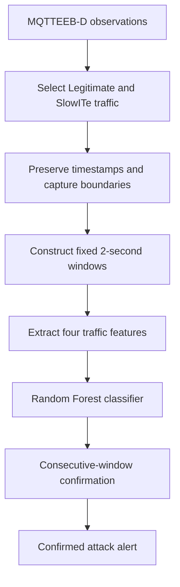

# MQTTGuard

### Lightweight Persistence-Aware Intrusion Detection for Slow MQTT Attacks

MQTTGuard is an embedded systems and AIoT research project that combines Random Forest classification with temporal persistence to detect SlowITe attacks in MQTT traffic. It investigates whether requiring consecutive suspicious predictions before confirming an attack can reduce false alerts while retaining label-run proxy recall and acceptable detection latency.

**Status:** Working ESP32/Wokwi implementation, trained Random Forest, verified C++ export, and actual MQTT reporting. See [current implementation status](docs/STATUS.md) and [measured results](docs/results/RESULTS.md). Final documentation integration is in progress.

**[Open the working Wokwi demo](https://wokwi.com/projects/478675756306751489)**

## Problem

Slow MQTT attacks can persist without the abrupt traffic increases associated with flooding. A classifier may identify suspicious traffic, but immediately turning every positive prediction into an alert can produce unnecessary alarms. MQTTGuard adds a small stateful confirmation layer after classification.

## Proposed Pipeline



Each window contains four features: observation count, mean TCP length, mean inter-arrival time, and mean MQTT keep-alive. The classifier predicts Legitimate or Suspicious.

| Configuration | Consecutive suspicious windows required |
| --- | ---: |
| Immediate Random Forest baseline | 1 |
| MQTTGuard, proposed configuration | 2 |
| Strict persistence comparison | 3 |

The same held-out classifier predictions will be used for all three comparisons. Requiring persistence introduces a detection-delay trade-off; its benefit must be measured.

## Dataset and Scope

The inspected official **MQTTEEB-D version 2** contains 222,813 rows, including **17,557 Legitimate** and **20,090 SlowITe** rows, plus **246 missing labels**. The cleaned CSV matches the combined four raw captures exactly by row multiset. All downloaded files passed publisher SHA-256 verification.

Initial work uses recorded traffic and local software processing to represent detection at an IoT gateway. Hardware deployment, live packet capture, cloud inference, multiclass detection, and automatic blocking are future work.

Raw CSVs are downloaded locally into `data/raw/` and excluded from Git. The official release is [available on Mendeley](https://data.mendeley.com/datasets/jfttfjn6tr/2) under CC BY 4.0. See the [dataset review](docs/DATASET_REVIEW.md) and [manifest](docs/DATASET_MANIFEST.json) for provenance and checksums.

**Dataset caveats:** `tcp_time_delta` repeats the absolute timestamp, so timing features must be recomputed. Benign traffic is sparse: capture 4 has no adjacent pure-benign two-second windows. This can make persistence appear more effective at suppressing false alarms; the methodology requires explicit checks for that effect.

## Download and Inspect

Requires Python 3.10+ and `curl`; no third-party Python packages are needed for inspection. Run from the repository root:

```bash
python3 scripts/download_dataset.py
python3 scripts/inspect_dataset.py
python3 -m unittest discover -s scripts -p "test_*.py" -v
```

Open `reports/dataset_preview.html` to view sample rows and summaries. Detailed evidence is saved in `reports/dataset_audit.json` and per-file window CSVs. Inspection does not train a detector. Generated reports remain local and can be regenerated.

## Evaluation

- **Classification:** precision, recall, F1-score, false-positive rate, and confusion matrix.
- **Operational detection:** false alert events, label-run proxy recall, missed episodes, and time to first confirmed alert.
- **Efficiency:** processing time per window; resource claims require measurements.

Chronological evaluation must retain capture boundaries and gaps. Mixed-class transition windows are excluded from classifier development, as proposed in the report; their treatment during operational evaluation is specified in the methodology. No experimental improvement is claimed yet.

## Documentation

- [Verified dataset findings and download source](docs/DATASET_REVIEW.md)
- [Product requirements and ordered build checklist](docs/PRD.md)
- [Step-by-step methodology and evaluation protocol](docs/METHODOLOGY.md)
- [Original report references and attribution corrections](docs/REPORT_REFERENCES.md)

**Planned stack:** Python, pandas, NumPy, scikit-learn, and plotting libraries. Installation and execution instructions will be added alongside working code.

## Future Work

Adaptive windows, two-of-three confirmation, additional attack classes, live MQTT monitoring, Raspberry Pi deployment, CPU and memory profiling, and broker or firewall integration.

## Team

- Ayati Rauthan
- Ireshi Rawat
- Pranav Tawakley

The project name follows the report's **MQTTGuard** spelling. The GitHub repository is named [`MQTTgaurd`](https://github.com/ayatinkering/MQTTgaurd).
