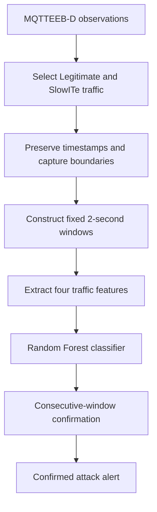

# MQTTGuard

### Lightweight Persistence-Aware Intrusion Detection for Slow MQTT Attacks

MQTTGuard is an embedded systems and AIoT research project that combines Random Forest classification with temporal persistence to detect SlowITe attacks in MQTT traffic. It investigates whether requiring consecutive suspicious predictions before confirming an attack can reduce false alerts while retaining attack-episode recall and acceptable detection latency.

**Status:** Research specification and implementation planning. This repository currently contains documentation; training code, executable commands, and measured results are not yet available.

## Problem

Slow MQTT attacks can persist without the abrupt traffic increases associated with flooding. A classifier may identify suspicious traffic, but immediately turning every positive prediction into an alert can produce unnecessary alarms. MQTTGuard adds a small stateful confirmation layer after classification.

## Proposed Pipeline

Each window contains four features: observation count, mean TCP length, mean inter-arrival time, and mean MQTT keep-alive. The classifier predicts Legitimate or Suspicious.

| Configuration | Consecutive suspicious windows required |
| --- | ---: |
| Immediate Random Forest baseline | 1 |
| MQTTGuard, proposed configuration | 2 |
| Strict persistence comparison | 3 |

The same held-out classifier predictions will be used for all three comparisons. Requiring persistence introduces a detection-delay trade-off; its benefit must be measured.

## Dataset and Scope

The project report selects **MQTTEEB-D** and its Legitimate and SlowITe classes. It reports 17,557 Legitimate and 20,090 SlowITe observations before windowing. These are report-derived counts, pending verification against the acquired dataset version.

Initial work uses recorded traffic and local software processing to represent detection at an IoT gateway. Hardware deployment, live packet capture, cloud inference, multiclass detection, and automatic blocking are future work.

Dataset files are not included. Record the source, version, checksum, license, and schema before use, and follow the dataset's redistribution terms.

## Evaluation

- **Classification:** precision, recall, F1-score, false-positive rate, and confusion matrix.
- **Operational detection:** false alert events, attack-episode recall, missed episodes, and time to first confirmed alert.
- **Efficiency:** processing time per window; resource claims require measurements.

Chronological evaluation must retain capture boundaries and gaps. Mixed-class transition windows are excluded from classifier development, as proposed in the report; their treatment during operational evaluation is specified in the methodology. No experimental improvement is claimed yet.

## Documentation

- [Product requirements and acceptance criteria](docs/PRD.md)
- [Methodology, evaluation protocol, and report references](docs/METHODOLOGY.md)

**Planned stack:** Python, pandas, NumPy, scikit-learn, and plotting libraries. Installation and execution instructions will be added alongside working code.

## Future Work

Adaptive windows, two-of-three confirmation, additional attack classes, live MQTT monitoring, Raspberry Pi deployment, CPU and memory profiling, and broker or firewall integration.

## Team

- Ayati Rauthan
- Ireshi Rawat
- Pranav Tawakley

The project name follows the report's **MQTTGuard** spelling. The GitHub repository is named [`MQTTgaurd`](https://github.com/ayatinkering/MQTTgaurd).
