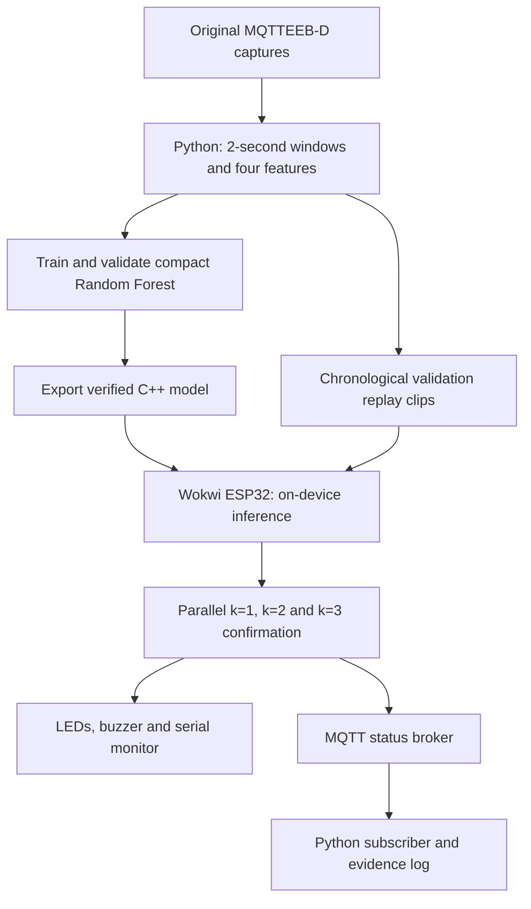

# MQTTGuard

**Trace-driven ESP32 simulation of a lightweight, persistence-aware intrusion detector for slow MQTT attacks.**

MQTTGuard is an Embedded Systems + AIoT course project. We train a compact Random Forest on recorded MQTTEEB-D traffic, export the learned model to C++, and run **actual inference and alert confirmation on an ESP32 simulated in Wokwi**. The ESP32 also publishes its computed status over MQTT to a laptop subscriber.

**[Open the working Wokwi demo](https://wokwi.com/projects/478675756306751489)** · **[Current status](docs/STATUS.md)** · **[Start here if taking over the project](docs/HANDOFF.md)**

## What the current version does



- **AI:** a trained 16-tree Random Forest, maximum depth 3; inference runs in firmware.
- **Embedded systems:** ESP32 C++, timed replay, GPIO, debounced buttons, state machines and a separate network task.
- **IoT:** MQTT security data and working status publication from Wokwi to an independent subscriber.
- **Simulation:** recorded network features are replayed into the simulated device. Feature extraction and training run on the host.

This is **not a live packet sniffer or a live SlowITe attack testbed**. Topic subscriptions do not provide the TCP/MQTT fields needed by the detector. Physical deployment, automatic blocking, ThingsBoard and raw-packet feature extraction on ESP32 remain future work.

## Try the demo

1. Open the Wokwi link and press **Start simulation**. No local model server is needed.
2. Default mode replays a recorded SlowITe excerpt through the actual model. The three LEDs show confirmation for k=1, 2 and 3; the buzzer sounds on a new k=2 event.
3. **NEXT TRACE** selects an excerpt; **PAUSE / PLAY** controls playback; **AI / TEST** switches to explicitly labelled scripted confirmation tests.
4. Read the serial monitor for predictions, window IDs, counters and the generated `TOPIC=` value.
5. For independent MQTT reception, run the subscriber below using that exact topic.

Scripted TEST mode deliberately bypasses AI to verify isolated positives, sustained positives, gaps and duplicates. It is not a classifier accuracy demonstration. Serial commands `verify` and `selftest` run complete-clip and connection-recovery diagnostics. See [the demo guide](docs/DEMO.md).

## Reproduce locally

Use Python 3.12, `uv`, `curl`, and `g++`. Python 3.12.14 and scikit-learn 1.9.1 were used for the checked-in results.

```bash
uv venv --python 3.12 .venv
uv pip install --python .venv/bin/python -r requirements.lock
python3 scripts/download_dataset.py
python3 scripts/inspect_dataset.py
.venv/bin/python scripts/train_pipeline.py
.venv/bin/python scripts/publish_results.py
.venv/bin/python scripts/bundle_firmware.py
.venv/bin/python -m pytest scripts -q
.venv/bin/python scripts/verify_demo_evidence.py
.venv/bin/python scripts/verify_wokwi_serial.py docs/evidence/wokwi-serial-full.txt
```

The training command generates the fitted model and replay predictions under `reports/experiment/`, summary JSON under `docs/results/`, and firmware model/replay headers. The bundle command creates the browser-friendly Wokwi files under `firmware/wokwi/`. **Regeneration does not update the online Wokwi project automatically.**

For a CPU-only Colab reproduction and versioned downloadable handoff, see [Colab instructions](docs/COLAB.md). Publishing now generates classification and persistence CSVs plus a confusion-matrix figure. Locally, run `.venv/bin/python scripts/package_ml_outputs.py` after training/publishing/bundling to create a ZIP with source scripts, model, firmware, results and provenance hashes.

For MQTT reception while Wokwi is running:

```bash
.venv/bin/python scripts/mqtt_status.py --topic 'mqttguard/PASTE_THE_RUN_ID/status' --seconds 120
```

Use the topic printed by the running simulation, not the placeholder. MQTT uses the public test broker `test.mosquitto.org:1883`; only ordinary demo status is published. Delivery is best-effort. A latest-status mailbox keeps network retries separate from inference; the public broker is not a performance benchmark or production security service.

## Measured research results

Primary split: train captures 1+2, validate 3, test 4. The same classifier predictions feed each confirmation policy.

| k | Clean false events | Observed SlowITe runs detected | Mean delay among detected runs |
| --- | ---: | ---: | ---: |
| 1 | 0 | 12/12 | 0.888 s |
| 2 | 0 | 12/12 | 3.555 s |
| 3 | 0 | 10/12 | 4.900 s |

Primary pure-window RF accuracy is **90.35%**, precision **100%**, recall **72.22%** and F1 **83.87%**. Accuracy and F1 describe the same model. Run detection and window recall are different metrics. See [research findings and pending experiments](docs/RESEARCH_FINDINGS.md) for the exact report claims and limitations, including false alarm starts versus benign time spent in alarm.

**This primary test does not demonstrate false-alarm reduction:** immediate alerting already has zero clean benign false events, and capture 4 has no adjacent pure-benign two-second windows. A separate capture-held-out study exposes the trade-off: on capture 1, k=2 changes clean false events from 66 to 3 while run detections change from 84/84 to 83/84. All captures come from one testbed/day.

The exported C++ model matched Python on **11,210 inputs**, including 321 threshold-boundary cases, with zero label disagreements. Twelve automated tests pass. Full target replay verification covers 90 observed MODEL rows, and a controlled broken-connection/recovery test passed while inference continued. See [embedded evidence](docs/evidence/EMBEDDED_VERIFICATION.md). See [full results and limitations](docs/results/RESULTS.md).

## Dataset

[MQTTEEB-D version 2](https://data.mendeley.com/datasets/jfttfjn6tr/2), CC BY 4.0. The inspected combined file contains 222,813 observations: 17,557 Legitimate, 20,090 SlowITe, other attack classes and 246 missing labels. Use original capture loops, not a concatenation of raw and cleaned copies.

The `tcp_time_delta` column repeats absolute timestamps; we recompute timing. Empty windows remain visible and break confirmation. Source labels enter fitting/scoring only, never embedded prediction. See [dataset audit](docs/DATASET_REVIEW.md).

## Documentation map

| Document | Purpose |
| --- | --- |
| [Handoff](docs/HANDOFF.md) | Current decisions, setup, file ownership, next work and pitfalls |
| [PRD](docs/PRD.md) | Current product requirements and acceptance status |
| [Methodology](docs/METHODOLOGY.md) | Exact dataset, training, replay and evaluation protocol |
| [Implementation](docs/IMPLEMENTATION.md) | Host/firmware interfaces, export, controls and networking |
| [Demo](docs/DEMO.md) | Repeatable presentation and troubleshooting |
| [Status](docs/STATUS.md) | Completed work, verification and outstanding limitations |
| [Results](docs/results/RESULTS.md) | Measured tables and plot |
| [Research findings](docs/RESEARCH_FINDINGS.md) | Report-ready findings, claim boundaries and remaining experiments |
| [Colab](docs/COLAB.md) | Fixed-version training notebook and complete ML handoff ZIP |
| [Evidence](docs/evidence/README.md) | Observed Wokwi and MQTT evidence |
| [References](docs/REPORT_REFERENCES.md) | Original bibliography and attribution corrections |

The original PDF describes the earlier host-only proposal. Repository documentation now defines the current ESP32/Wokwi version. Existing PDFs have not been rewritten.

## Team and development support

Ayati Rauthan · Ireshi Rawat · Pranav Tawakley.

Repository: [ayatinkering/MQTTguard](https://github.com/ayatinkering/MQTTguard). The local directory retains the earlier `MQTTgaurd` spelling.

Development used the reviewed K-Dense scikit-learn and scientific-critical-thinking skills; they are optional guidance, not runtime dependencies. Attribution and reinstall details are in [the implementation guide](docs/IMPLEMENTATION.md).
