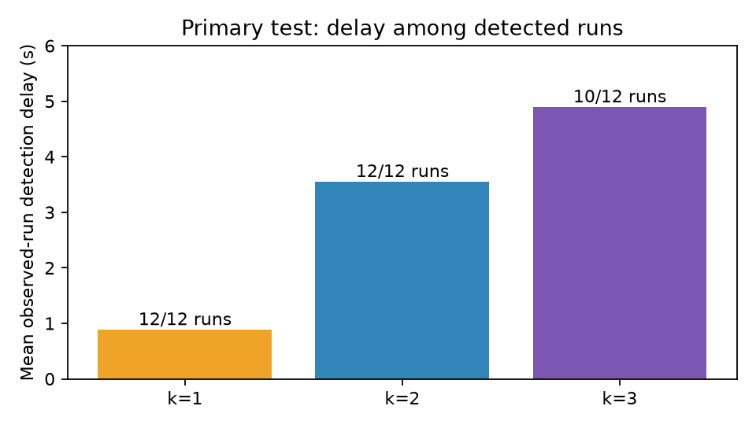

# Measured MQTTGuard results

Generated from the checked-in JSON summaries. Dataset: original MQTTEEB-D v2 captures. Labels define observed run proxies, not independently timed physical attack executions.

Primary RF accuracy is **90.3509%**, SlowITe precision **100.00%**, recall **72.22%**, and F1 **83.87%**. These are different metrics of the same model.

Confusion matrix (true rows / predicted columns; legitimate, SlowITe): `[[372, 0], [55, 143]]`. Scored subset: 570 pure-class windows; empty and mixed/unknown/other windows are excluded from these classification scores.

Exports: [classification CSV](classification_metrics.csv), [persistence CSV](persistence_metrics.csv), and [classification figure](classification_metrics.png). `base_classifier_window_FPR` repeats the pre-confirmation classifier FPR; it is not post-confirmation FPR. Benign-window exposure sums eligible two-second windows, not independently observed continuous benign sessions. Clean false-event starts and time spent confirmed on benign windows are distinct outcomes.

For the completed study and metric caveats, see [extended results](../research/RESULTS.md) and [methodology](../METHODOLOGY.md).

## Primary test: train 1+2, validate 3, test 4

| Model | k | Window F1 | False clean events | Detected runs | Mean delay (s) |
| --- | ---: | ---: | ---: | ---: | ---: |
| RF | 1 | 0.8387 | 0 | 12/12 | 0.888 |
| RF | 2 | 0.8387 | 0 | 12/12 | 3.555 |
| RF | 3 | 0.8387 | 0 | 10/12 | 4.900 |
| rate | 1 | 0.7184 | 0 | 12/12 | 0.888 |
| rate | 2 | 0.7184 | 0 | 12/12 | 2.888 |
| rate | 3 | 0.7184 | 0 | 12/12 | 4.888 |

**Interpretation:** RF immediate alerting already has zero clean benign false events on capture 4. k=2 preserves 12/12 observed run detections but increases mean delay; k=3 misses two runs. Capture 4 has no adjacent pure-benign windows, so its zero k>=2 false events cannot establish general suppression effectiveness. Other-class/unknown/mixed event starts are reported separately in JSON.

## Separately defined capture-held-out robustness

Each fold uses the next capture cyclically for validation and the remaining two for training. These are different fitted models, not independent sites or days.

| Held-out | k | RF false clean events | Runs detected | Mean delay (s) |
| --- | ---: | ---: | ---: | ---: |
| 1 | 1 | 66 | 84/84 | 0.925 |
| 1 | 2 | 3 | 83/84 | 3.172 |
| 1 | 3 | 3 | 81/84 | 5.091 |
| 2 | 1 | 16 | 24/24 | 1.165 |
| 2 | 2 | 0 | 24/24 | 3.332 |
| 2 | 3 | 0 | 23/24 | 5.184 |
| 3 | 1 | 10 | 12/12 | 0.841 |
| 3 | 2 | 0 | 12/12 | 3.175 |
| 3 | 3 | 0 | 12/12 | 5.675 |
| 4 | 1 | 0 | 12/12 | 0.888 |
| 4 | 2 | 0 | 12/12 | 3.555 |
| 4 | 3 | 0 | 10/12 | 4.947 |

In held-out capture 1, k=2 changes false clean events from 66 to 3 and run detection from 84/84 to 83/84. This is evidence of a trade-off within this dataset; it is not proof of generalization to new brokers or real attacks. Full rate-baseline and ideal-pure-label diagnostic results are supplied alongside this file.

## Embedded model verification

Selected RF: 16 trees, maximum depth 3. Export uses original floating-point thresholds and soft voting, without quantization.

Host-compiled C++ versus Python: 11210 inputs including 321 boundary cases; 0 label disagreements; maximum probability difference 0.0.

Wokwi timing is simulated execution time; laptop batch timings are not ESP32 hardware benchmarks. The classifier operates on host-extracted feature windows. Live capture, physical power measurements and automatic mitigation are not implemented.

